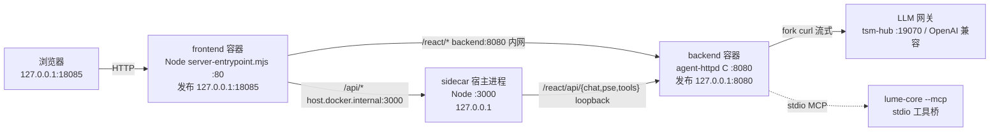

> 中文版架构文档。项目主页：[README.md](README.md)（英文）/ [README.zh.md](README.zh.md)（中文）。
> 本文描述运行时的真实拓扑与通信契约，与源码（`docker-compose.yml`、`frontend/server-entrypoint.mjs`、`sidecar/server.js`、`agent-httpd/src/`）保持一致。

# resolve-lume 架构文档

## 1. 系统定位

resolve-lume 是 **resolve-studio 核心能力的 lume 技术栈重实现**：用 C 单二进制后端（`agent-httpd`）+ `lume-core` 自定义工具桥 + React 前端，复刻 **PSE 多智能体编排**（Planner / Specialist / Evaluator 三角色）与**流式聊天**。

设计要点：

- **后端零 Node 运行时**：`backend` 容器运行时只有 `agent-httpd`、`lume-core` 两个 C 二进制 + `debian:bookworm-slim`，不装 node / python / make。
- **前端零反向代理依赖**：`frontend` 容器用纯 Node 内置模块（`http`/`fs`/`path`/`crypto`）自写反代与静态托管，不依赖 nginx。
- **宿主 sidecar 承载高特权能力**：文件读写、shell、内置工具、会话/作业/技能等 `agent-httpd` 没有的 `/api/*` 全部放在宿主 macOS 常驻的 Node 进程里，直接操作宿主真实路径。

---

## 2. 运行拓扑



**端口与绑定（全部仅 `127.0.0.1`，不对局域网暴露）**

| 进程 | 地址 | 角色 |
|---|---|---|
| 浏览器入口 | `127.0.0.1:18085` | 用户访问点（frontend 容器发布端口）|
| frontend 容器 | 容器内 `:80` | 静态托管 + 反向代理 |
| sidecar（宿主）| `127.0.0.1:3000` | 网关 + 功能后端 |
| backend 容器 | `127.0.0.1:8080` | AI 运行时（agent-httpd）|
| LLM 网关 | 宿主 `:19070`（tsm-hub）| OpenAI 兼容 chat/completions |

**跨边界说明**

- `frontend → sidecar`：容器内经 `host.docker.internal:3000` 打宿主 loopback（macOS Docker Desktop / OrbStack 的 `host-gateway` 别名）。
- `sidecar → backend`：宿主进程经 `127.0.0.1:8080` loopback 直接访问（backend 发布到宿主 loopback）。
- `backend → LLM`：容器内经 `host.docker.internal` 访问跑在宿主的 LLM 网关（如 tsm-hub），由 `LLM_API_URL` 配置。

---

## 3. 三大组件职责

### 3.1 frontend —— 反向代理 + 静态托管（`frontend/server-entrypoint.mjs`）

不是 nginx。`nginx.conf` 是退役参考文件（文件头已注明）。实际运行时是一个纯 Node `http` 服务，职责：

- **静态托管** Vite 产物（`dist/`），SPA fallback 到 `index.html`；`/assets/` 做 docroot 穿越防护（`safeAssetPath` 拒绝 `..` 逃逸，不会回退到 index.html 掩饰）。
- **反向代理**：
  - `/api/*` → `host.docker.internal:3000`（宿主 sidecar）
  - `/react/*` → `backend:8080`（compose 内网直连）
  - `/health` → 200（容器探活）
- **安全头 / 约束**：
  - **fail-closed 共享密钥**：`SIDECAR_TOKEN` 缺失或长度 < 16 直接 `process.exit(1)`，源码内无任何默认值。
  - **Host allowlist**：拒绝非预期 `Host`（防 DNS rebinding 把请求引到 127.0.0.1）。
  - **Token 注入去重**：转发上游前先删掉客户端传来的 `X-Sidecar-Token`，再强制覆盖为自身值（避免客户端控制同名头）。
  - **保留原始 Host**：`/react/*` 请求保留客户端 `Host`，因为 agent-httpd 在 Host 被改写到上游地址时会回 403（本项目真实踩坑）。
  - **SSE 不缓冲**：`server.timeout/requestTimeout = 0`，避免长流被 Node 默认 300s 截断。
  - CSP / `X-Content-Type-Options` / `Referrer-Policy` / `X-Frame-Options: DENY` 等安全头。

### 3.2 sidecar —— 宿主网关 + 功能后端（`sidecar/server.js`）

**不在 compose 内**，由 `make sidecar-host-start` 经 `sidecar/launcher.js` 在宿主 macOS 常驻（监听 `127.0.0.1:3000`），`make sidecar-host-stop` 停止。职责：

- **补齐 `/api/*`**：`agent-httpd` 只暴露 `/react/api/*` 与工具注册；会话、作业、任务、技能、MCP、文件系统浏览等由 sidecar 提供。
- **SSE 方言转换**：把 lume 的 SSE 方言转成前端方言（lume 输出仅 `data:` 帧）。
- **内置工具本地执行**：`read/write/shell/calc/echo/analyze-dir/skill-run/system-info/privacy-audit` 等真实现在 sidecar 内跑，直接读写宿主真实路径。
- **请求形态转换**：前端 `POST /api/chat` 的 `{messages:[], model}` → agent-httpd 的 `{message, history, model}`（顶层 `message` 而非 `messages[]`）。
- **PSE 开关 + free/paid provider 状态**：`/api/pse`（GET/POST 开关）、`/api/pse-provider`（GET/POST 选 free/deepseek）、`/api/models`（free/paid 模型列表）。
- **鉴权**：除 `/health` 外，所有 `/api/*` 必须携带正确 `X-Sidecar-Token`，否则 401（纵深防御——即使本机其它进程能连到 sidecar:3000，也开不了可写文件/跑 shell 的 API）。
- **工具桥 allowlist 强制**：`/api/tools/call` 被 agent 桥（经 `SIDECAR_TOOLS_URL`）调用时，服务端强制校验 `AGENT_TOOL_ALLOW`，未授权的内置工具返回 403（此前"暴露 24 个工具"只约束模型可见、HTTP 面仍给全部 44 个，已被修复）。

### 3.3 backend / agent-httpd —— C 单二进制 AI 运行时

`agent-httpd` 是 **resolve-studio 后端的 C 移植版**（源码注释："port of resolve-studio's McpService / session-store / runPseOrchestrator"）。职责：

- **ReAct Agent 循环**：`src/agent/agent.c` 实现单 agent 的 tool_choice 循环。
- **PSE 三角色编排**：`src/agent/pse.c`，在 `agent_round()`（一次性阶段：Planner / Evaluator）与 `agent_run_ex()`（Specialist 的工具循环）之上编排。
- **LLM 通道**：`src/agent/llm.c` 用 `fork` + `curl -N` 拉取流式 chat/completions，逐 delta 转发到页面。
- **工具注册**：`src/agent/tools_api.c` 暴露 `/react/api/tools` 等工具端点；`src/agent/tools.c` 是工具实现。
- **会话持久化**：`src/agent/db_layer.c` / `sqlite_tool.c`（SQLite）。
- **MCP 客户端**：`src/agent/mcp.c`，连接 `lume-core --mcp` 等 stdio server。
- **请求路由**：`src/http/http_route.c` 区分 fast path（静态/OPTIONS）、chat 路由、react 保留路径、CGI、Vite dev 代理。
- **安全**：`src/security/auth.c`（htpasswd 登录）、`ratelimit.c`、`loginlimit.c`、`bcrypt.c`。**注意**：htpasswd 未配置时鉴权默认关闭——当前所有端口仅绑 127.0.0.1，不存在外网暴露面；若公网部署必须补 htpasswd。

启动由 `deploy/backend-entrypoint.sh` 执行：`agent-httpd -p 8080 -w 8 -L /var/log/agent-httpd/access.log`（PORT / WORKERS 来自 compose 环境变量）。

### 3.4 lume-core —— MCP 工具桥

以 `--mcp` 模式作为 stdio MCP server 由 agent-httpd 拉起，加载 `lume-tools/tools.lume`，把 lume 的自定义 `.lume` 工具暴露给 C 后端的 Agent。compose 的 `mcp-servers.json` 仅登记一项：

```json
{ "id": "lume-tools", "transport": "stdio",
  "command": "lume-core", "args": "--mcp /app/lume-tools/tools.lume", "approval": false }
```

> 限制与现状（2026-11-09 更新）：agent-httpd 的 MCP 客户端**只支持 stdio**（`mcp.c` 里非 stdio 直接 skip），且 backend 镜像不含 node/npx，所以 5 个 npx server 一直以来都没接上。
>
> 现在的做法是「代理桥」：`lume-tools/mcp_http_proxy.sh` 用容器自带的 `sh`+`curl` 做 stdio ↔ Streamable HTTP 翻译（按响应头保持 `mcp-session-id`，兼容纯 JSON 与 SSE 两种响应），backend 侧统一以 `command=/bin/sh`、`args="<脚本> <upstream-url>"` 拉起，因此 `fs`/`fetch`/`git`/`memory`/`think` 五座 HTTP 桥全部被 agent-httpd 正常握手，工具以 `<serverId>__<tool>` 注册。注意 `args` 在 `cfg_add_server` 里只接受空格分隔的字符串，写成 JSON 数组会被丢掉。
>
> 网络前提：`mcp-*` 容器在外部网络 `tsm-hub_default` 上，backend 必须同时加入 `default` 与 `tsm-hub_default` 才能解析这些主机名。前端面板（sidecar 读 `deploy/mcp-servers.json`）跑在宿主上、解析不到容器名，故其状态以后端真实注册的工具快照为准。
>
> 容器归属：**五座 MCP 桥全部在 tsm-hub 的 docker-compose.yml 里**（`container_name` 固定、`restart: unless-stopped`、node TCP 健康检查）：`fs`/`memory`/`think` 原本就在，`fetch`/`git` 于 2026-11-09 从 resolve-lume 收归，lume 仓不再定义任何 MCP 容器（原 `deploy/mcp-bridges.compose.yml` 已删除），避免两仓 `docker compose up` 撞容器名。镜像与依赖也一并收归 tsm-hub：`deploy/mcp-bridge.Dockerfile`、`deploy/mcp-git.Dockerfile`（均 `FROM node:20-alpine`，构建产物 186MB / 200MB；2026-11-09 已作为回滚重建源保留，回滚镜像本身已删除），依赖统一挂 `tsm-hub/mcp/node_modules`（lume 侧 vendored 副本已删，省 ~85MB）。`mcp-fs` / `mcp-git` 对工作区是 `:rw`（lume 要能写文件、git 要能 add/commit），`mcp-git` 用 `GIT_AUTHOR_*` / `GIT_COMMITTER_*` 注入提交身份，否则容器内 `git_commit` 报 "Author identity unknown"。lume 侧 `make mcp-bridges-up/-down/-logs` 已改为转发到 tsm-hub 的同名服务。
> 网关替换（2026-11-09）：`mcp-fetch` / `mcp-think` 已从 supergateway 换成自研 C 网关 `mcp-gateway`（源码与 Dockerfile 在 `tsm-hub/deploy/`），镜像 186MB→136MB，且容器里少了一个 node 进程（fetch 62→17MiB、think 116→35MiB anon）。并行模型：每条 HTTP 连接一个线程、一个 `mcp-session-id` 一个子进程、会话内按内部 id 混流收发；已知边界：最多 4 个会话（满了淘汰最久未用的空闲会话）、空闲 30 分钟回收、`GET /mcp` 的 SSE 下行流未实现（回 405）。五个 `mcp-*` 已全部切换：`fs`/`memory`/`fetch`/`think` 用 `mcp-gateway:latest`（136MB），`git` 用 `mcp-gateway-git:latest`（150MB）；回滚镜像 `mcp-bridge:latest` / `mcp-bridge-git:latest`（186/200MB）已于同日 `docker rmi` 回收 386MB，需要回滚时用上述 Dockerfile 重建。稳态内存（cgroup anon，跑过工具后）由约 684MiB 降到约 371MiB，少的是每容器那层 supergateway 的 node 进程。

### 3.5 peer / A2A 面 —— tsm-hub 作为只读能力节点

tsm-hub 侧新增了 A2A 面（`/.well-known/agent-card.json`、`/a2a`，以及需要签名的 `/peer/health`、`/peer/invoke`、`/peer/relay`），把「工具/技能/MCP/用量/provider 健康」以只读 capability 暴露给 lume 侧 agent。两侧端点：lume peer `127.0.0.1:18114`（节点名 `resolve-lume`）、tsm-hub `127.0.0.1:19070`（节点名 `tsm-hub`）。

签名走 derived 模式：`key_for(node)=hmac_sha256(PEER_ROOT,"peer:"+node)`，待签名串为 `node + "\n" + ts + "\n" + nonce + "\n" + scope`，GET 的 scope 为 `GET <path>`（不含 query）、POST 为 `POST <path> + "\n" + body`，query 参数 `node/ts/nonce/sig`，时间窗默认 120s；两侧 `PEER_ROOT` 必须同值（本项目两侧均为同一 16 字符根密钥）。

> 注册表是这套机制最容易漏的一环，且**两边都要登记对方的实际节点名**：tsm-hub 的 `data/peers-identity.json` 要含 `resolve-lume`（不是历史别名 `lume-a2a`），lume 的 `.data/peers-identity.json` 要含 `tsm-hub`（或在 `PEER_REG_DIR` 自注册目录放 `tsm-hub.json`）。缺任一边即单向不通，报错固定为 `unknown peer '<name>' (not in registry)` —— 看到它先核节点名，别去核密钥。
>
> 生效方式不同：lume 的 `known()` 每次请求重读注册表（改完即生效）；tsm-hub 启动时加载，改完要 `docker compose restart tsm-hub`。

实测（2026-11-09）：未签名 `/peer/health` → `missing auth params`；以 `resolve-lume` 身份签 tsm-hub → `ok:true, mode:"derived"`；以 `tsm-hub` 身份签 lume → `ok:true`（双向通）；编造节点 `rogue` → `unknown peer`；`POST /a2a` 带 `params.metadata.capability=tsm.overview` → `completed` 并回 artifact（不带 capability 只回 `input-required`）；`/peer/relay` → 410；`/api/admin/a2a/overview`、`/tasks` 需 `X-Admin-Token`，200 正常。

---

## 4. 关键通信契约

### 4.1 聊天请求形态转换

| 层 | 形态 |
|---|---|
| 前端 `POST /api/chat` | `{ messages: [{role,content}], model }` |
| sidecar 转换 | 取最后一条 `user` 为 `message`，其余为 `history` |
| agent-httpd `POST /react/api/chat` | `{ message, history, model }`（**顶层 `message`**，非 `messages[]`）|

> 实测坑：最初误用 `messages[]` 调后端会回 `empty message`；后端只认顶层 `message`。

### 4.2 SSE 方言与重连纪律

- lume 输出 SSE 仅 `data:` 帧；sidecar 负责转成前端方言。
- **`chat` / `tool-run` 是 POST 非幂等**：断流只报"连接中断"，**绝不自动重发**（避免重复副作用，如重复跑工具 / 重复写入）。
- **job GET 流（seq 追加日志）**：按指数退避重连 + `snapshot/seq` 去重。
- 所有代理层 `proxy_buffering off`，SSE 端到端不缓冲。

### 4.3 模型白名单与 free/paid 切换

- `LLM_ALLOWED_MODELS`：C 后端**仅校验前端下发的 `model` override**；`LLM_MODEL`（兜底）不受限。空 = 不限制。
- 前端开关：
  - `/api/models` 返回 `{免费, 付费}` 对（默认 `agnes-2.0-flash` / `deepseek-v4-flash`），`LLM_FREE_MODEL` / `LLM_PAID_MODEL` 可覆盖。
  - `/api/pse-provider`（GET/POST 选 `free` / `deepseek`）控制 PSE 编排走哪档模型。
- compose 固定 `PSE_ENABLED=false`：普通 chat 路由无条件不跑 PSE，由 UI 开关决定转发到 `/react/api/pse`（三角色）还是 `/react/api/chat`（单 agent）。

### 4.4 工具调用路由

```
POST /api/tool/run  (来自 UI 工具面板)
   └─ name ∈ BUILTIN_NAMES ?
        ├─ 是 → sidecar 本地 runBuiltinSSE（含 panel-only 审计日志）
        └─ 否 → proxySSE 到 agent-httpd /react/api/tool/run

POST /api/tools/call (来自 agent 桥 SIDECAR_TOOLS_URL)
   └─ name ∈ BUILTIN_NAMES ?
        ├─ 是 → 服务端强制 AGENT_TOOL_ALLOW 校验；通过才 executeBuiltinTool，否则 403
        └─ 否 → proxyJSON 到 agent-httpd /react/api/tools/call
```

内置工具共 40 个 schema（`builtin-tools.json` 从 resolve-studio `/api/tools` 抓取），其中 **9 个本地真实现**（echo / calc / read / write / shell / analyze-dir / skill-run / system-info / privacy-audit），其余为占位提示。`BUILTIN_NAMES` 是全集，`AGENT_TOOL_ALLOW` 是 agent 桥可调用的子集（服务端强制）。

---

## 5. PSE 三角色编排

PSE（Planner / Specialist / Evaluator）是 resolve-studio 的核心编排模式，在 resolve-lume 中由 C 后端 `pse.c` 复刻：

- **Planner**：拆解任务、规划步骤（一次性 `agent_round`）。
- **Specialist**：执行具体工具调用（工具启用循环 `agent_run_ex`）。
- **Evaluator**：评审产物、给出结论（一次性 `agent_round`）。

角色系统提示来自 `souls/{planner,specialist,evaluator}/SOUL.md`（每文件上限 256KB，`pse.c` 中 `PSE_SOUL_MAX`）。`PSE_SOULS_DIR`（compose 设为 `/app/souls`）指定根目录。编排过程中阶段正文在 delta 流到页面的同时被捕获为 reasoning。

---

## 6. souls 角色与技能体系

`souls/` 目录同时承载两类资产：

- **PSE 三角色**：`planner/`、`specialist/`、`evaluator/` —— 各含 `SOUL.md`（系统提示），是 PSE 编排的必需项。
- **领域技能（Skill）**：`weekly-investment/`、`article-write/`、`code-review/`、`rust-review/`、`post-comment/`、`hot-news-post/`、`tech-comment-draft/` 等 —— 各含 `SKILL.md` + `scripts/`，供 Agent 调用完成具体任务（如 `weekly-investment/scripts/portfolio-check.mjs` 做投资组合诊断）。

每个 soul 目录结构：`SOUL.md`（角色/系统提示）+ `SKILL.md`（技能说明，三角色目录无此项）+ `scripts/`（可执行脚本）。

---

## 7. 构建与镜像

**`Dockerfile.backend`（三阶段）**

1. `c-build`：在 `debian:bookworm-slim` 编译 `agent-httpd`（gcc / make / libsqlite3-dev）。
2. `core-build`：同样编译 `lume-core`。
3. `runtime`：`debian:bookworm-slim` + `curl`/`ca-certificates`/`libcrypt1`/`libsqlite3-0`；只拷两个 C 二进制 + `souls`/`lume-tools`/`.data`/www 占位。运行时**无 node、无 python、无 make**，ldd 证实仅依赖 libc/libm/libsqlite3/libcrypt。

**`frontend/Dockerfile`**

1. `build`：`node:24-bookworm-slim` 跑 `npm run build`（用 npmmirror 源）。
2. `runtime`：同基础镜像，只拷 `dist/` + `server-entrypoint.mjs`（纯 Node 内置模块，**无需 `npm install`**——历史上的 `http-proxy` 是死依赖）。

**`docker-compose.yml`**：编排 `backend` + `frontend` 两容器（均 `security_opt: no-new-privileges`、`cap_drop: ALL`、`restart: unless-stopped`、端口仅绑 `127.0.0.1`）。`sidecar` 不在 compose（宿主常驻）。`agent-httpd`、`lume-core` 作为 vendored 同名目录（从 GitHub release 拉源码）参与构建。

**`vendor/`**：peer 面自带的 `lume` 二进制（`vendor/lume/bin/lume`，二进制被 `.gitignore` 忽略、`.vendor-stamp` 入库），让 peer 节点不再依赖兄弟 checkout 的 `../../lume`。

**构建上下文加固（`.dockerignore`）**

仓库根与 `frontend/` 各有一份 `.dockerignore`，均排除 `.env` / `.env.*`：

- `frontend/Dockerfile` 的 `runtime` 阶段用 `COPY . .` 把前端上下文整体拷入镜像。若本地开发不慎把 `.env` 留在 `frontend/` 下，会被一起烤进镜像层，造成凭据泄露——`.dockerignore` 将其挡在构建上下文之外。
- 仓库根 `.dockerignore` 是纵深防御：`Dockerfile.backend` 当前只 `COPY` 指定目录，理论上不会烤根 `.env`；排除 `.env` 是为了防止未来有人把 backend 改成 `COPY . .` 时，本地 `.env` 被无意带进镜像。

`.env` 在本机权限为 `0600` 且仅被 `.gitignore` 忽略（不入库）；`.env.example` 全为占位符。构建期密钥隔离与运行期 fail-closed token、凭据屏蔽共同构成三层防护（见第 8 节）。

---

## 8. 安全模型

| 控制点 | 实现 |
|---|---|
| 暴露面最小化 | 所有端口仅绑 `127.0.0.1`；frontend/backend 经 compose 发布，sidecar 仅 loopback |
| 共享密钥 fail-closed | `SIDECAR_TOKEN` 必填随机值（≥16 字节），源码无默认；frontend / sidecar 缺失即退出 |
| 防 DNS rebinding | frontend `ALLOWED_HOSTS` / `ALLOWED_ORIGINS` 白名单 |
| 路径穿越防护 | `/assets/` 经 `safeAssetPath` 拒绝 `..` 逃逸，不回退 index.html |
| Token 注入去重 | 上游转发前删除客户端 `X-Sidecar-Token` 再强制覆盖 |
| 工具桥服务端鉴权 | `/api/tools/call` 强制 `AGENT_TOOL_ALLOW` 子集，未授权 403 |
| 凭据屏蔽 | `lume-core` 的 `env()` 屏蔽含 `TOKEN/SECRET/API_KEY/PASSWORD` 的变量名（因此 sidecar→backend 的工具代理变量刻意避开 `*_TOKEN`，改用 `SIDECAR_TOOLS_AUTH`）|
| 容器加固 | `no-new-privileges` + `cap_drop: ALL` + 最小基础镜像 |
| 传输安全（SSE）| 全链路 `proxy_buffering off`，不截断长流 |
| 会话 ID 熵源 | `agent-httpd` `session_id_new` 使用 **16 字节 OS 级随机数**（非 `rand()/time()` 等弱源），保证会话标识不可预测；缺失/失败走 fail-closed，不回落弱随机 |
| 构建期密钥隔离 | 根与 `frontend/` 的 `.dockerignore` 排除 `.env` / `.env.*`，纵深防御 `COPY . .` 把本地密钥烤入镜像（详见第 7 节）|

**部署注意**

- C 后端 `htpasswd` 未配置时鉴权**默认关闭**。当前所有端口仅绑 `127.0.0.1`，无外网暴露面，可接受；若改为 `0.0.0.0` 公网部署，**必须**补 `htpasswd` 鉴权。
- 当前为本地工具，无隐私政策 / ICP 备案不构成现行义务；公网部署需补充。

---

## 9. 已知限制与路线图

- **未含**：job 持久化/续跑、前端外围面板、Python PSE 框架（两端共享外部依赖）。
- **MCP 已打通**：agent-httpd 只支持 stdio，故 5 座 Streamable HTTP 桥由 `lume-tools/mcp_http_proxy.sh` 做协议翻译后以 stdio 接入（`fs`/`fetch`/`git`/`memory`/`think` 全部 resident，工具数 46 → 99）；`deploy/mcp-servers-router.stub.json` 仍为空数组，用于阻止 router 注入 npx server。
- **导出脱敏**：前端 `export.ts` 会剥除账户名、掩码凭据、截断 3000 字（含私有工作区根名剥离）。
- **本地纪律**：项目遵循 "local commit only, no push"；`agent-httpd` / `lume-core` 已从 git 子模块改为 vendored 同名目录（从 GitHub release 拉源码），不再多仓协同提交。

---

## 10. 与 resolve-studio 的移植映射

| resolve-studio（原）| resolve-lume（现）|
|---|---|
| Node/TypeScript 后端（McpService / session-store / runPseOrchestrator）| `agent-httpd` C 单二进制（`src/agent/mcp.c` / `db_layer.c` / `pse.c`）|
| Python PSE 框架 | PSE 编排内嵌于 C（`pse.c`）|
| 前端 React 聊天 UI | 同栈 Vite+React（`frontend/`）|
| 后端原生工具集 | sidecar 内置工具（`builtin-exec.js`，9 真实现 + 占位）|
| 直接对外 REST | 前端反代 + 宿主 sidecar 网关（fail-closed token）|
| 单仓部署 | 主仓（含 vendored 的 agent-httpd / lume-core 同名目录） + 宿主 sidecar |
